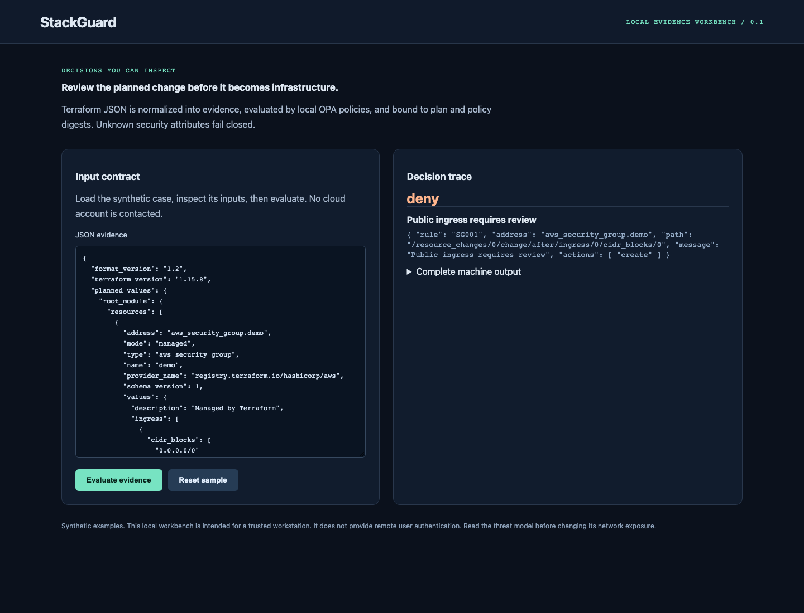

# StackGuard

[](https://github.com/jayekwere/stackguard/actions/workflows/verify.yml)
[](LICENSE)

**Terraform plan review with local OPA enforcement.**

A TypeScript CLI and local workbench that parse Terraform plan JSON, normalize planned resource changes, invoke real OPA/Rego, and produce digest-bound review evidence. The CLI exits nonzero on unsafe or unassessed changes. It never applies Terraform.



## Run locally

Requires Node 24.13+ or Node 26, and a trusted workstation. The initial setup downloads locked dependencies and OPA. Afterwards the core synthetic CLI and UI demos work offline. No cloud account or paid service is required. The pinned OPA installer supports Linux amd64/arm64 and macOS arm64.

```sh
git clone https://github.com/jayekwere/stackguard.git
cd stackguard
npm ci --ignore-scripts
node scripts/install-opa.mjs
npm run build
npm run demo
npm start
```

Open [http://127.0.0.1:8080](http://127.0.0.1:8080). For a container demo, run `docker compose up --build`. Compose publishes only to loopback, uses UID 10001, drops capabilities, denies privilege escalation and makes the root filesystem read-only. No input is persisted by the web evaluator. The default network posture is local-only. Do not expose a demo listener as a production service.

## What it enforces

- SG001 rejects public IPv4 and IPv6 ingress. SG002 requires all S3 public access block controls. SG003 protects tagged resources from deletion, replacement or state removal.
- SG004 recursively evaluates Terraform true/false unknown markers, ignores computed descriptions, and blocks unknown security attributes, SG005 blocks unsupported active resource types, and SG006 rejects public ACLs. SG007 and SG008 reject malformed policy attributes.
- `check` returns 0 for allow, 1 for deny, and 2 for invalid evidence or policy execution failure. No undefined OPA result becomes an allow.
- Review evidence contains resource addresses, planned actions, exact JSON field pointers, planned-input and policy digests. Policy bytes are copied to a private temporary file before evaluation to bind the decision to the recorded policy.

## Inputs, integrations and evidence

```sh
node dist/src/main.js check samples/unsafe-plan.json review.md
# Expected exit 1. Inspect review.md and the JSON report.
```

The included sample is actual `terraform show -json` output from Terraform 1.15.8 and AWS provider 6.20.0. It contains only fictional identifiers and synthetic provider credentials. It was generated without refreshing or applying resources. Reproduce from `examples/terraform` with `terraform init`, `terraform plan -refresh=false -out=sample.tfplan`, and `terraform show -json sample.tfplan`. Do not apply this deliberately unsafe fixture.

`policy/spacelift.rego` adapts the documented `input.terraform.resource_changes` envelope. Both packages must be attached. Local tests exercise the adapter with real-plan data and malformed envelopes. Attachment to a real Spacelift stack is **unverified**. Use [Spacelift plan policy documentation](https://docs.spacelift.io/self-hosted/latest/concepts/policy/terraform-plan-policy) and [OPA Terraform guidance](https://www.openpolicyagent.org/docs/terraform).

Generated machine output is committed in [samples/output.json](samples/output.json). The [architecture](docs/architecture.md), [threat model](docs/threatmodel.md), [verification record](docs/verification.md), and [distinct scope](docs/portfolio-scope.md) explain the implementation and its boundaries. Strict runtime models are authoritative; published [schemas](schemas) document the contracts. External Terraform and SARIF metadata can carry provider extensions; security-relevant fields receive explicit validation.

## Verify

```sh
npm run verify
npx playwright install chromium
npm run test:browser
docker build -t stackguard:local .
node scripts/container-smoke.mjs stackguard:local
```

CI runs lint, strict TypeScript checks, unit/adversarial tests, measured coverage, builds, the local demo, browser interactions, dependency audit and a hardened container smoke check. Node source coverage is reported transparently; it is not a claim of complete path coverage. Every Action uses a verified full commit SHA, checkout credentials are disabled, and the verification workflow has only contents read permission. Browser installation and container builds need network during setup. Artifact retention is 14 days. Repository maintainers control policy and workflow changes.

## Limits and trust

This is a narrow policy gate, not a complete infrastructure scanner. It covers AWS security groups, S3 public access blocks, S3 ACLs, and protected deletion tags. `terraform_data` has no network security attributes and is permitted. Other changed managed types fail closed. Data sources and no-op resources are outside change enforcement. Equivalent public networks expressed as several narrower CIDRs are not classified as world-open by SG001. Provider correctness, all Terraform checks, IPv4/IPv6 network semantics beyond these rules, resource drift and runtime authorization remain outside this gate.

The report plan digest hashes `JSON.stringify` of parsed JSON, not the binary `.tfplan`. A deployment pipeline must bind its approved plan JSON to the exact binary plan and require this check before apply. Branch protection and an apply pipeline are not configured by this repository. Terraform plans can contain secrets even when Terraform marks values sensitive; keep real plan files private. Findings intentionally omit planned attribute values.

OPA binaries come from a pinned release and verified SHA-256 values. `OPA` is a trusted operator override; the report records the pinned distribution expected by setup, not an independently authenticated version of an arbitrary override. The local web server has no user accounts and is intended for loopback. There are no live AWS calls, GitHub App publishing, or cloud mutations in this project.

 

See [SECURITY.md](SECURITY.md) and [CONTRIBUTING.md](CONTRIBUTING.md). MIT covers this repository's original code; dependencies retain their respective licenses.
