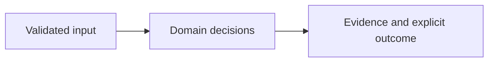

# Architecture

Terraform JSON --> Zod normalization --> private policy snapshot --> OPA --> evidence report --> CLI exit gate

| Component/source | Responsibility |
| --- | --- |
| `src/main.ts:5` | CLI check/demo/serve, exit 0/1/2 |
| `src/engine.ts:51` | Terraform evidence normalization and action/value validation |
| `src/engine.ts:126` | Bounded OPA invocation using exact policy bytes |
| `policy/spacelift.rego:4` | Separate fail-closed Spacelift envelope adapter |
| `src/io.ts:21` | Loopback HTTP workbench and fixed static asset mapping |

## Effective resources

| Deployment or consumer | Configuration and location | Recipients or authority | Enforcing control |
| --- | --- | --- | --- |
| CLI/web policy process | OPA override or .tools/opa; fixed policy/stackguard.rego copied into a private OS temporary directory | Trusted operator and OPA; normalized plan travels on stdin | No shell, 10-second timeout, 2 MiB output bound; policy snapshot removed after use |
| Web listener | HOST or 127.0.0.1; PORT or 8080 | Reachable clients, no accounts | Host allowlist, same-origin POST, JSON content type and 1 MiB streaming limit |
| Spacelift gate | Both policy packages attached by an operator; input.terraform envelope | External policy runner | Local adapter tests exist; real stack attachment remains unverified |

## Trust and decisions

Untrusted JSON passes known-field and semantic validation before a fixed OPA query. Imported Terraform metadata is retained but does not select executables or policy paths. The environment-controlled executable and repository policy are trusted operator configuration. A client cannot choose them through HTTP. The Spacelift adapter has its own input rejection rules and invokes the same policy package.

Core domain decisions are separated from HTTP, CLI and external integration adapters. Runtime models reject unsupported contracts instead of interpreting arbitrary instructions. The UI renders supplied strings with textContent. Container startup uses UID 10001 and loopback publication through Compose. Setup downloads dependencies and optional tools once; core synthetic evaluation does not require a network.

## Unresolved integration scope

No apply pipeline, branch protection, live AWS account, or real Spacelift stack has been verified. Policy scope is deliberately narrow. Combined narrower public CIDRs, runtime drift and full provider semantics are outside the current rule set.

See the README for exact setup, sample outputs, decision semantics and limits. The threat model distinguishes hypotheses from source-established controls.
